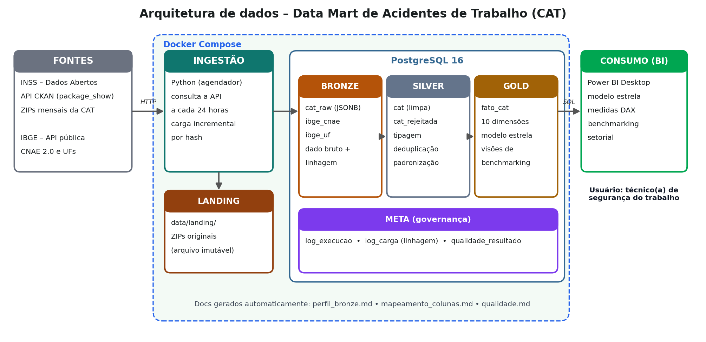
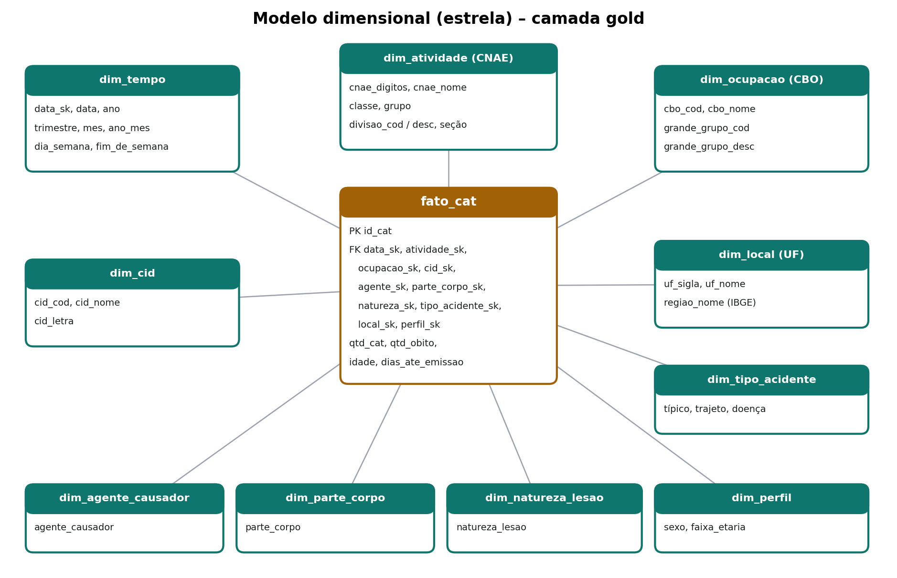

# SST-CAT Data Mart

Data mart de acidentes de trabalho que se **atualiza sozinho pela API** do portal de dados abertos do INSS, enriquecido pela API do IBGE e servido em um painel de benchmarking setorial no **Power BI**.

Projeto Aplicado da Pós-Graduação em Engenharia e Arquitetura de Dados (XP Educação).

---

## COMECE AQUI: comandos

Pré-requisitos: **Docker Desktop aberto**, **DBeaver** e **Power BI Desktop** instalados (o Power BI Desktop é gratuito e baixado pela Microsoft Store).

### Passo 1 – Abrir o terminal na pasta do projeto

1. Descompacte o arquivo `sst-cat-datamart.zip`.
2. Abra a pasta `sst-cat-datamart` no Explorador de Arquivos.
3. Clique com o botão direito em um espaço vazio da pasta e escolha **"Abrir no Terminal"**.

Todos os comandos abaixo são digitados nesse terminal.

### Passo 2 – Subir tudo

```
docker compose up -d --build
```

Esse único comando liga três peças:

- **postgres**: o banco de dados;
- **agendador**: consulta a API do INSS, carrega os dados e **repete a verificação a cada 24 horas**, trazendo sozinho os meses novos que forem publicados;
- a imagem do **pipeline**, para execuções manuais.

A primeira carga começa automaticamente e baixa todos os meses publicados. Pode levar alguns minutos.

### Passo 3 – Conferir se está tudo rodando  (print do R1)

```
docker compose ps
```

Devem aparecer `sst_postgres` e `sst_agendador` com status **running/Up**.

### Passo 4 – Acompanhar a carga pela API  (print do R3)

```
docker compose logs -f agendador
```

Você vai ver os meses sendo descobertos na API e carregados. Quando aparecer **"Próxima verificação"**, a carga terminou. Aperte `Ctrl + C` para sair dos logs (o agendador continua rodando).

### Passo 5 – Conectar o DBeaver ao banco

No DBeaver: **Nova conexão → PostgreSQL** e preencha:

| Campo | Valor |
|---|---|
| Host | `localhost` |
| Porta | `5432` |
| Banco de dados | `sst` |
| Usuário | `sst` |
| Senha | `sst123` |

Clique em **Testar conexão** (aceite baixar o driver, se ele pedir) e depois em **Concluir**.

Em seguida, abra o arquivo `sql/50_consultas_evidencias.sql` no DBeaver (**Arquivo → Abrir arquivo**), associe à conexão `sst`, clique em uma consulta e aperte **Ctrl + Enter**. Cada consulta está marcada com o requisito (R3, R5, R6...) de que ela é evidência.

### Passo 6 – Conferir o mapeamento de colunas (antes da Sprint 2)

Abra o arquivo `docs/mapeamento_colunas.md` (dá para abrir no Bloco de Notas ou no VS Code). Se algum campo aparecer como **não encontrada**, me avise para ajustarmos a regra.

---

## Outros comandos úteis

```
docker compose run --rm pipeline                  # roda o pipeline completo agora, sem esperar o agendador
docker compose run --rm pipeline --etapas ingestao  # só consulta a API e carrega meses novos
docker compose run --rm pipeline --etapas canonica silver gold qualidade   # refaz só as transformações
docker compose logs -f agendador                  # acompanha o agendador (Ctrl + C para sair)
docker compose restart agendador                  # força uma verificação imediata na API
docker compose stop                               # desliga tudo (os dados continuam salvos)
docker compose start                              # liga de novo
docker compose down -v                            # APAGA banco e painel para começar do zero
```

Depois de alterar qualquer arquivo em `src/` ou `sql/`, rode `docker compose up -d --build` de novo para o Docker usar a versão nova.

**Mudar a frequência da atualização:** copie `.env.example` para `.env` e altere `INTERVALO_HORAS` (por exemplo, `168` para uma vez por semana). Depois rode `docker compose up -d`.

---

## Como a atualização pela API funciona

O INSS publica a CAT no portal de dados abertos, que roda sobre a plataforma CKAN. A **API CKAN** (`/api/3/action/package_show`) devolve, em JSON, a lista de recursos do conjunto de dados, com o endereço de cada arquivo mensal.

O fluxo do agendador, a cada ciclo:

1. Chama a API e descobre quais meses estão publicados.
2. Compara com o que já está no banco (tabela `meta.log_carga`).
3. Baixa e carrega **apenas** os meses novos ou republicados (identificados pelo hash do arquivo).
4. Se entrou algo novo, atualiza as referências do IBGE (também via API) e recalcula as camadas silver e gold e as regras de qualidade.

Observação técnica: a API do INSS informa **quais** arquivos existem e onde estão; os registros em si são entregues pelo INSS em arquivos mensais compactados. Por isso o pipeline usa a API para descobrir e controlar as atualizações e depois lê o conteúdo de cada arquivo. Já a API do IBGE devolve os dados diretamente em JSON.



## Camadas de dados

- **Landing** (`data/landing/`): arquivos originais, sem alteração.
- **Bronze**: cada linha do CSV guardada em JSONB, com linhagem. Mudanças de layout da fonte não quebram a carga.
- **Silver**: datas convertidas, códigos e descrições separados, “não classificado” tratado, duplicatas removidas. Registros rejeitados ficam em `silver.cat_rejeitada` com o motivo.
- **Gold**: modelo estrela com `fato_cat` (1 linha = 1 CAT) e 10 dimensões, além das visões do painel.
- **Meta**: logs de execução, controle das cargas e resultado das 15 regras de qualidade.



## Montando o painel no Power BI (Sprint 3)

O Power BI vai ler direto o modelo estrela da camada **gold**. Como o agendador mantém o banco atualizado pela API, basta clicar em **Atualizar** no Power BI para o painel trazer os dados mais recentes.

### 1. Conectar ao banco

1. Abra o Power BI Desktop e clique em **Obter dados → Mais... → Banco de dados PostgreSQL**.
2. Servidor: `localhost:5432` | Banco de dados: `sst` | Modo: **Importar**. Clique em OK.
3. Na tela de credenciais, escolha a aba **Banco de dados**: usuário `sst`, senha `sst123`.
4. Se aparecer um aviso sobre conexão não criptografada, clique em OK para continuar (o banco está no seu próprio computador).

### 2. Escolher as tabelas

No Navegador, marque as tabelas do schema **gold** (todas começam com `gold.`):

`fato_cat`, `dim_tempo`, `dim_atividade`, `dim_ocupacao`, `dim_cid`, `dim_agente_causador`, `dim_parte_corpo`, `dim_natureza_lesao`, `dim_tipo_acidente`, `dim_local`, `dim_perfil`

Clique em **Carregar**. Depois, renomeie cada tabela no painel **Dados** (à direita) tirando o prefixo `gold` (por exemplo, `gold fato_cat` vira `fato_cat`). Isso deixa as fórmulas mais simples.

### 3. Conferir os relacionamentos (o modelo estrela)

Clique no ícone **Exibição de modelo** (à esquerda). O Power BI costuma ligar sozinho as tabelas pelas colunas de mesmo nome. Confira se a `fato_cat` está ligada a cada dimensão:

| fato_cat | dimensão |
|---|---|
| `data_sk` | `dim_tempo[data_sk]` |
| `atividade_sk` | `dim_atividade[atividade_sk]` |
| `ocupacao_sk` | `dim_ocupacao[ocupacao_sk]` |
| `cid_sk` | `dim_cid[cid_sk]` |
| `agente_sk` | `dim_agente_causador[agente_sk]` |
| `parte_corpo_sk` | `dim_parte_corpo[parte_corpo_sk]` |
| `natureza_sk` | `dim_natureza_lesao[natureza_sk]` |
| `tipo_acidente_sk` | `dim_tipo_acidente[tipo_acidente_sk]` |
| `local_sk` | `dim_local[local_sk]` |
| `perfil_sk` | `dim_perfil[perfil_sk]` |

Se faltar alguma ligação, arraste a coluna da `fato_cat` até a coluna correspondente da dimensão. Todas devem ser **muitos para um (*:1)**, com a dimensão do lado "1". **Tire um print desta tela: é uma ótima evidência do modelo estrela.**

### 4. Criar as medidas (DAX)

Selecione a tabela `fato_cat`, clique em **Nova medida** e crie uma por vez:

```
Total CATs = COUNTROWS(fato_cat)

Óbitos = SUM(fato_cat[qtd_obito])

% Óbitos = DIVIDE([Óbitos], [Total CATs])

Idade média = AVERAGE(fato_cat[idade])

% no setor =
DIVIDE(
    [Total CATs],
    CALCULATE([Total CATs], REMOVEFILTERS(dim_agente_causador))
)

% no Brasil =
DIVIDE(
    CALCULATE([Total CATs], REMOVEFILTERS(dim_atividade)),
    CALCULATE([Total CATs], REMOVEFILTERS(dim_atividade), REMOVEFILTERS(dim_agente_causador))
)

Índice de concentração = DIVIDE([% no setor], [% no Brasil])

Total CATs (meses completos) =
CALCULATE([Total CATs], dim_tempo[publicacao_incompleta] = FALSE())
```

Formate `% Óbitos`, `% no setor` e `% no Brasil` como **Porcentagem** (guia Ferramentas de medida).

O **Índice de concentração** é o coração do benchmarking: maior que 1 significa que aquele agente causador pesa mais no setor selecionado do que na média do Brasil.

### 5. Montar os visuais

| Visual | Campos |
|---|---|
| **Segmentação** (filtro de setor) | `dim_atividade[divisao_desc]` |
| **Segmentação** (filtro de ano) | `dim_tempo[ano]` |
| **Cartões** | `Total CATs`, `Óbitos`, `% Óbitos`, `Idade média` |
| **Gráfico de linhas** – evolução mensal | Eixo X: `dim_tempo[ano_mes]` · Eixo Y: `Total CATs` |
| **Barras agrupadas** – setor x Brasil | Eixo Y: `dim_agente_causador[agente_causador]` · Valores: `% no setor` e `% no Brasil` · Filtro do visual: Top 10 por `Total CATs` |
| **Tabela** – índice de concentração | `agente_causador`, `Total CATs`, `% no setor`, `% no Brasil`, `Índice de concentração` |
| **Barras** – partes do corpo | `dim_parte_corpo[parte_corpo]` · `Total CATs` |
| **Barras** – ocupações | `dim_ocupacao[cbo_nome]` · `Total CATs` (Top 10) |
| **Rosca** – tipo de acidente | `dim_tipo_acidente[tipo_acidente]` · `Total CATs` |
| **Mapa ou barras** – UF do empregador | `dim_local[uf_sigla]` · `Total CATs` |

**Meses com publicação incompleta.** A `dim_tempo` tem a coluna `situacao_publicacao` (COMPLETA, INCOMPLETA ou FORA DA COBERTURA) e a coluna `publicacao_incompleta` (verdadeiro ou falso). Em alguns meses, o INSS publicou muito menos CATs do que o normal, e mostrar esses meses sem aviso sugeriria uma queda de acidentes que não aconteceu. Por isso:

- no gráfico de linhas da evolução mensal, use a formatação condicional da cor (ou a legenda) com `situacao_publicacao`, deixando os meses incompletos em cinza;
- crie uma segmentação com `dim_tempo[publicacao_incompleta]`, para que o usuário possa ver só os meses completos;
- acrescente uma nota no visual: *"Meses em cinza: publicação incompleta pela fonte (INSS)."*

Salve o arquivo como `painel/benchmarking_sst.pbix` dentro da pasta do projeto.

### 6. Atualizar os dados

Sempre que quiser os dados mais recentes, clique em **Página Inicial → Atualizar**. O caminho completo fica: **API do INSS → agendador → PostgreSQL → Power BI**.

Observação: o Power BI Desktop é gratuito. Publicar e compartilhar o painel on-line exige licença paga, mas isso não é necessário para o projeto: os prints e o arquivo `.pbix` são as evidências.

## Evidências para o relatório

| Sprint | Requisito | Evidência |
|---|---|---|
| 1 | R1 Ambiente containerizado | Print do `docker compose ps` |
| 1 | R2 Arquitetura | `docs/arquitetura.png` |
| 1 | R3 Coleta via APIs | Prints do JSON das APIs no navegador, dos logs do agendador e das consultas R3 no DBeaver |
| 2 | R4 Tratamento e modelagem | Consultas R4 no DBeaver, `docs/modelo_estrela.png` e o diagrama do schema gold no DBeaver |
| 2 | R5 Qualidade de dados | `docs/perfil_bronze.md`, `docs/qualidade.md` ou consulta R5 |
| 3 | R6 Painel de BI | Print da Exibição de modelo do Power BI e prints do painel, com e sem filtro de setor |
| 3 | R7 Documentação | Este README, o arquivo `.pbix` e o link do GitHub |

Dica para o R4: no DBeaver, clique com o botão direito no schema **gold → Exibir diagrama**. Ele desenha o modelo estrela automaticamente a partir das chaves estrangeiras.

## Estrutura do projeto

```
docker-compose.yml             Postgres + agendador + pipeline
Dockerfile                     Imagem Python do pipeline
src/agendador.py               Verifica a API periodicamente e atualiza o data mart
src/run_pipeline.py            Executa as etapas na ordem
src/ingest_cat.py              Ingestão via API CKAN do INSS (bronze)
src/load_ibge.py               Referências via API do IBGE (bronze)
src/profile_report.py          Perfil dos dados brutos -> docs/perfil_bronze.md
src/build_canonical.py         Mapeamento de colunas -> docs/mapeamento_colunas.md
src/quality.py                 Regras de qualidade -> docs/qualidade.md
sql/00_infra.sql               Schemas e tabelas de controle
sql/10_silver.sql              Limpeza, padronização e deduplicação
sql/20_gold.sql                Modelo estrela e visões
sql/50_consultas_evidencias.sql  Consultas para os prints do relatório (DBeaver)
docs/                          Diagramas e relatórios gerados automaticamente
painel/                        Arquivo do Power BI (.pbix), criado por você na Sprint 3
```

## Fontes e licenças

- INSS, Comunicações de Acidente de Trabalho (CAT), Plano de Dados Abertos, licença Creative Commons Atribuição: https://dadosabertos.inss.gov.br
- IBGE, API de serviços de dados (CNAE e localidades): https://servicodados.ibge.gov.br
- Radar SIT (Inspeção do Trabalho), usado para conferência: https://sit.trabalho.gov.br/radar/
